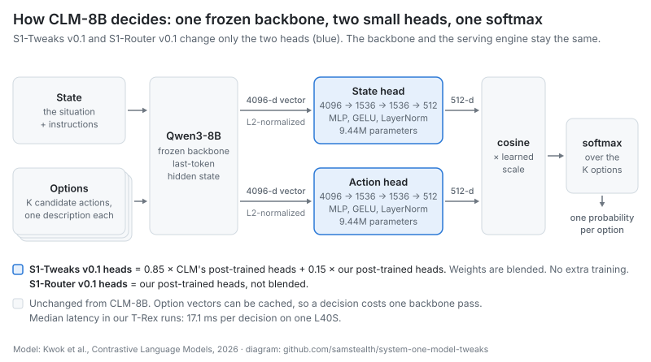

# System One Model Tweaks

**Two drop-in heads and five measured experiments for CLM-8B, an open "System One" model from Stanford and NVIDIA Research. It does not write text. It picks one option from a list in a single pass: 16 to 17 ms per decision on one L40S in our T-Rex runs.**

[](LICENSE)
[](https://github.com/samstealth/system-one-model-tweaks/actions/workflows/ci.yml)
[](https://github.com/samstealth/system-one-model-tweaks/releases/tag/v0.1)

We post-trained an open decision model to pick tools and routes far better, and it forgot how to play a dinosaur game. Blending 15% of the new weights into the old ones got the game back with its safety shield on: 14 of 15 courses survived in the check run, against 15 of 15 for the original (19 of 20 against 20 of 20 over both runs). The blend kept gains of 1.8 to 5.4 points on 6 of 8 held-out tests that we built from public sources. With the shield off, the original still plays far better.

<p align="center"></p>

<sub>One recorded course (seed 0) with the safety shield on, 18.5 seconds. Top: CLM-8B. Middle: S1-Router v0.1, our post-trained head before any blend. Bottom: S1-Tweaks v0.1, the 15% blend. This is one run, not the result: in a later run S1-Tweaks v0.1 lost this same course once, its one loss in 20 games. Drawn from the recorded frames by [`render_trex3.py`](innovations/render_trex3.py), with crash times in [`trex-three-heads.json`](assets/media/trex-three-heads.json).</sub>

This repo is the lab notebook: two heads you can download, five experiments, every measured number tied to a result file or a dated run note, and the failures left in. The five ideas come from the last chapter of Vizuara AI Labs' System One workshop. This is an independent project. It is not an official CLM release and it is not affiliated with Vizuara AI Labs.

```bash
git clone https://github.com/samstealth/system-one-model-tweaks
cd system-one-model-tweaks
python -m venv .venv && source .venv/bin/activate
# Linux, optional: the CPU build of torch skips the large CUDA wheels
pip install torch --index-url https://download.pytorch.org/whl/cpu
pip install -e .
# no GPU needed: scores 60 real decisions on your CPU
python examples/demo_cpu.py
```

<picture><source media="(prefers-color-scheme: dark)" srcset="assets/hero-dark.svg"></picture>

<sub>Grey is CLM-8B, blue is S1-Tweaks v0.1. Same frozen backbone and same serving engine. Only the head weights differ. The held-out gains are modest, T-Rex is a near-tie only with the safety shield on, and all of this is slice-scale work. The table below has the same numbers as text. See [Limitations](#limitations).</sub>

**Jump to:** [scoreboard](#the-scoreboard) · [pick a head](#pick-a-head) · [lab notebook](#the-lab-notebook) · [what is a System One model?](#what-is-a-system-one-model) · [quickstart](#quickstart) · [five experiments](#the-five-experiments) · [what failed](#what-failed) · [limitations](#limitations)

## The scoreboard

CLM-8B is a frozen Qwen3-8B plus two small trained heads (18.9M parameters together). **S1-Tweaks v0.1** is a new pair of heads: every weight is 85% CLM-8B's and 15% ours, with no training after the blend. Both columns use the same backbone, the same vectors and the same scoring code. Top-1 accuracy in % unless the row says otherwise. Chance is a random pick among the options. Changes are differences of the printed numbers.

| Test (rows) | Chance | CLM-8B | S1-Tweaks v0.1 | Change |
|---|---|---|---|---|
| **Held-out tests, our builds from public sets** | | | | |
| BFCL v3, our 10-option build (1,252) | 10.0 | 65.4 | 68.7 | +3.3 |
| MASSIVE, intent routing (2,951) | 10.0 | 26.3 | 31.7 | +5.4 |
| HWU64, intent routing (1,072) | 10.0 | 29.5 | 34.4 | +4.9 |
| Bitext, support routing (2,000) | 10.0 | 16.1 | 17.9 | +1.8 |
| SciQ, science questions (1,000) | 25.0 | 56.5 | 60.3 | +3.8 |
| QASC, science questions (923) | 12.5 | 36.4 | 39.0 | +2.6 |
| MMLU test, mixed knowledge (1,997) | 25.0 | 28.9 | 29.2 | flat (+0.3) |
| MedMCQA, medical questions (1,999) | 25.0 | 29.0 | 29.1 | flat (+0.1) |
| **CLM-8B's own agent benchmarks** | | | | |
| T-Rex, shield on: games survived, two runs | | 20/20 | 19/20 | near-tie, one game behind |
| T-Rex, shield on: picks that agree with the planner, seeds 0 to 14 | | 64.8% | 54.3% | -10.5 points |
| T-Rex, shield on: shield interventions, seeds 0 to 14 | | 15,668 | 21,022 | about a third more |
| T-Rex, shield off: deaths in 5 courses | | 22 | 45 | CLM-8B far better (score 221 against 55). Neither head survives a course |
| DeepSWE after CLM's own fine-tune: tasks solved of 38, mean of 5 seeds | | 31.0 | 30.8 | tie within seed noise |
| **Q&A on our rebuilt slice** | | | | |
| Tricky Q&A (gold answer against up to 10 hard negatives) | | 66.1 | 66.6 | flat (+0.5) |
| General Q&A (in-batch retrieval) | | 81.8 | 81.7 | flat (-0.1) |

Read these before you quote the table:

- **What T-Rex measures.** T-Rex is CLM's real-time benchmark: keep Chrome's offline dinosaur alive for 60 seconds per course. The model never sees the game. A physics planner labels each of three actions Safe or Unsafe, and one of them Best, and the model picks from that text in real time. With the shield on, an unsafe answer is replaced, so survival measures the model and the shield together. Over seeds 0 to 14 the harness counted 21,022 shield interventions in 51,524 decisions for S1-Tweaks v0.1 and 15,668 in 50,696 for CLM-8B ([per-seed files](results/innovations/trex_15seeds/)). Most are answers that the shield's check changed when they arrived: 19,014 against 14,710. Top picks that the planner had labelled unsafe were replaced 1,995 times against 941.
- **T-Rex is a near-tie, not a tie.** The first run (seeds 0 to 4) was 5/5 for both heads. It is also the run the 15% blend was picked on. A second run over seeds 0 to 14 was 14/15 against 15/15, with mean best score 685.8 against 697.0. The one death was on seed 0. On the ten new seeds both heads survived 10 of 10. So the 20 games cover 15 distinct courses, and seeds 0 to 4 were played twice.
- **With the shield off, CLM-8B is far better, and neither head survives.** Over 5 seeds CLM-8B dies 22 times, scores 221 and survives 0 of 5 courses. S1-Tweaks v0.1 dies 45 times and scores 55. 45 deaths is 9 in every course, and it is what every failing head gets here, including CLM's own mid-trained head from before its agent training. So the blend keeps T-Rex survival with the shield on and loses the skill with the shield off.
- **The held-out tests are our builds, and the gains are smaller than in-distribution.** Tool choice is +15.7 on Glaive, a source we trained on, and +3.3 on BFCL, a source we did not. We built every held-out row as a multiple-choice question from a public set, so these are not the benchmarks' own metrics: the BFCL row is not the BFCL score that CLM reports. The option wording is ours (`name: description`, and for routing `name: Route the ticket to name.`). CLM-8B never saw it and we did not test other wordings, so part of the gain may be the heads learning our template. Wrong options are the set's own wrong answers, or other labels or tools from the same source. Seven of the eight sources were never trained on. MMLU is a held-out split and not a new source: we trained on MMLU's `auxiliary_train` set, which is built from other datasets.
- **How sure the gains are.** A paired bootstrap over the same rows gives a 95% interval for each change ([`heldout_paired.json`](results/innovations/heldout_paired.json)): BFCL 2.32 to 4.31, MASSIVE 4.54 to 6.34, HWU64 3.54 to 6.44, Bitext 1.20 to 2.50, SciQ 2.40 to 5.30, QASC 1.08 to 4.23. For MMLU (-0.75 to 1.30) and MedMCQA (-0.85 to 0.90) it includes zero. In rows the gains are small: BFCL +41 of 1,252, MASSIVE +160 of 2,951, HWU64 +53 of 1,072, Bitext +37 of 2,000, SciQ +38 of 1,000, QASC +24 of 923. All six also rise at every blend weight we scored. MMLU and MedMCQA are near chance for every head: with 4 options chance is 25%, and no head here passes 32%.
- **This is slice-scale work.** The post-training run was 400 steps on 233k choice rows, not a full-scale retrain. The Q&A tests use a rebuilt 12k-pair slice with contexts cut to 512 tokens, so they read lower than CLM's published numbers (66.1% here against 68.5% published for the same head). 424 of the slice's 11,998 test pairs (3.5%) are also in the two published chunks that our post-training replayed, so the Q&A rows are not fully held out for our two heads ([`data_checks.json`](results/innovations/data_checks.json)).
- **DeepSWE is a tie after fine-tuning, not a kept skill.** Each head is first fine-tuned on DeepSWE steps with CLM's own script, as CLM does, and then scored. So the row says that the blend is as good a starting point for that fine-tune. Per seed: 31, 32, 30, 31, 31 for CLM-8B and 30, 32, 30, 31, 31 for S1-Tweaks v0.1. There is little room to move: a random pick solves 28 of the 38 tasks and a perfect pick 34.

<details>
<summary>In-distribution tests (an upper bound: these test rows share sources with our training data)</summary>

| Test | Chance | CLM-8B | S1-Tweaks v0.1 | S1-Router v0.1 |
|---|---|---|---|---|
| Tool choice (Glaive function calling) | 10.0 | 56.0 | 71.7 | 97.5 |
| Ticket routing (Banking77) | 10.0 | 22.1 | 26.9 | 82.8 |
| Intent routing (CLINC) | 10.0 | 29.0 | 37.4 | 85.7 |
| Label reading (pick the option that carries a tag such as Correct or Safe) | 24.6 | 32.9 | 35.3 | 51.9 |
| ARC | 25.0 | 30.6 | 33.0 | 42.1 |
| CommonsenseQA | 20.0 | 30.7 | 33.6 | 46.3 |
| Tricky Q&A | | 66.1 | 66.6 | 68.2 |
| General Q&A | | 81.8 | 81.7 | 79.9 |

About 4 in 10 Glaive states carry earlier turns of the dialogue and an end-of-text marker (510 of the 1,129 test rows), because the builder keeps everything before the first function call. Those turns can hint at the tool. The two Q&A rows share 3.5% of their test pairs with the replay chunks, as noted above.

</details>

Raw numbers: [`results/innovations/`](results/innovations/) (`heldout.json`, `heldout_paired.json`, `trex.json`, `deepswe.json`, `data_checks.json`, one JSON per run). Full write-up: [`innovations/RESULTS.md`](innovations/RESULTS.md).

## Pick a head

| | CLM-8B (original) | S1-Tweaks v0.1 | S1-Router v0.1 |
|---|---|---|---|
| Pick it when | you need CLM's exact behaviour. It is also the least bad head if a T-Rex-like task must run with no safety shield | you want to stay close to CLM-8B (85% of its weights) and gain a few points on tool choice and routing. Not for T-Rex-like use without a safety check | the job is routing or tool choice and nothing like T-Rex matters |
| How it is made | released by the CLM authors | 85% CLM-8B + 15% S1-Router, blended in weight space, no training | CLM-8B's head plus 400 post-training steps on choice data |
| Tool choice, BFCL, our build (held-out) | 65.4% | 68.7% | 76.8% |
| Intent routing, MASSIVE (held-out) | 26.3% | 31.7% | 60.7% |
| T-Rex games survived, shield on | 20 of 20 | 19 of 20 | 0 of 5 |
| General Q&A | 81.8% | 81.7% | 79.9% |
| File | `CLM_v0.1-8B.pt` | `s1_tweaks_v0.1.pt` | `s1_router_v0.1.pt` |

<picture><source media="(prefers-color-scheme: dark)" srcset="assets/heldout-dark.svg"></picture>

**S1-Router v0.1** is our fully post-trained head, with no blending. On the held-out test it is ahead of CLM-8B by 11.4 to 34.4 points on six sources. On MMLU (+2.6, interval 0.30 to 4.81) and MedMCQA (+1.0, interval -1.05 to 3.15) the lead is small, and both tests sit near chance. It pays for the gains: it survives 0 of 5 T-Rex courses (17 deaths) and loses 1.9 points of general Q&A. It was also tested less, with no DeepSWE run and no 15-seed T-Rex run.

All three files use CLM's own checkpoint layout (`state_head`, `action_head`, `logit_scale`, `cfg`), so the official CLM engine serves any of them with `--ckpt`. Our two files are on the [v0.1 release page](https://github.com/samstealth/system-one-model-tweaks/releases/tag/v0.1), about 75 MB each. Sizes, checksums and intended use are in [`MODEL_CARD.md`](MODEL_CARD.md).

## The lab notebook

The [workshop this repo builds on](https://github.com/VizuaraAI/system-one-from-scratch) ends with five ideas for improving CLM-8B. We ran all five ([below](#the-five-experiments)). The fifth turned into a story, told here in the three rounds it took on 22 and 23 November 2026.

**Round 1. Teach it to choose.** A System One model is asked "which of these options?". So we built training rows shaped like that question: one situation, up to 10 options, and the wrong options of the same question as the hard negatives. That gave 233k rows built from public tool-calling, routing and multiple-choice sets. About 39k of them are a label-reading set: one random option carries a tag such as Correct or Safe, the others carry the opposite tag, and the state asks for the tagged one. It was meant to teach the kind of label reading that T-Rex needs. We post-trained CLM-8B's head on all of it for 400 steps, with 40% of every batch replaying CLM's own Q&A data so it would not forget that. It worked. On test rows from the same sources, tool choice went from 56.0% to 97.5%, ticket routing from 22.1% to 82.8% and intent routing from 29.0% to 85.7%. This head is now S1-Router v0.1.

**Then we ran the dinosaur.** CLM ships a real-time benchmark: Chrome's offline dinosaur game, 60 seconds per course, over 3,000 decisions per course. CLM-8B survived 5 of 5 courses. Our new head survived 0 of 5 and died 17 times. The clip at the top of this page is one of those courses. The label-reading rows did not save it: the head got better at reading tags (32.9% to 51.9%, chance 24.6%) and still lost the game.

**The clue.** CLM's own mid-trained head, the stage before the authors' agent post-training, also survives 0 of 5. So the T-Rex skill comes from that last training stage, and our 400 steps wrote over it.

**Four fixes that failed.** One of them kept the game, by learning nothing.

| Attempt | T-Rex courses survived, shield on | Tool choice (Glaive) |
|---|---|---|
| Gentler run: lower learning rate, 200 steps, 50% replay | 0/5 | 93.3% |
| Distill toward CLM-8B's head while training | 0/5 | 83.1% |
| Distill plus a strong L2 anchor to CLM-8B's weights | 5/5 | 56.4% (CLM-8B: 56.0%) |
| Add 118k agent steps from ADP, with distillation | 2/5 | 83.0% |

**Round 2. A blend, with no training.** Take the two heads and blend their weights: 85% CLM-8B, 15% ours. One command, no gradient step:

```bash
python -m innovations.interpolate --a clm --b s1-router --alpha 0.15 --out my_blend.pt
```

The names `clm` and `s1-router` download the two heads. Local `.pt` files work too.

<picture><source media="(prefers-color-scheme: dark)" srcset="assets/blend-tradeoff-dark.svg"></picture>

| Share of our head | T-Rex survived, shield on, 5 seeds | Picks that agree with the planner, same 5 seeds | BFCL (held-out) | MASSIVE (held-out) |
|---|---|---|---|---|
| 0 (CLM-8B) | 5/5, then 15/15 over seeds 0 to 14 | 65.4% | 65.4% | 26.3% |
| **0.15 (S1-Tweaks v0.1)** | 5/5, then 14/15 over seeds 0 to 14 | 55.1% | 68.7% | 31.7% |
| 0.175 | 3/5 | 49.3% | 69.5% | 32.2% |
| 0.2 | 4/5 | 50.8% | 69.7% | 33.3% |
| 0.25 | 4/5 | 42.9% | 70.5% | 35.5% |
| 0.5 | 0/5 | 62.6% | 74.8% | 45.8% |
| 1 (S1-Router v0.1) | 0/5 | 27.9% | 76.8% | 60.7% |

Held-out accuracy rises with every step of the blend. T-Rex survival does not. 15% is the largest blend that survived all five courses in its 5-seed run. 17.5%, 20% and 25% lost two, one and one of five, which 5 seeds cannot tell apart from 15%: it lost one of 20, and CLM-8B's own head lost one of five in the baseline's run of 6 November. Only 50% clearly fails, with 0 of 5 and 41 deaths. Agreement with the planner drops at the first step and is no clean gauge either: the 50% blend agrees 62.6% of the time and still dies 41 times. So 15% is not a safe middle. It is the one blend we tried that survived its five courses and gained anything.

**Round 3. Try to break it.**

- **More seeds.** Over seeds 0 to 14, S1-Tweaks v0.1 survived 14 and CLM-8B survived 15. The one death was on seed 0, which the same head survived in the first run, so real-time play is not fully deterministic. On the ten new seeds both survived 10 of 10. Together: 19 of 20 games against 20 of 20.
- **Shield off.** Without the safety shield, every blend we made dies 45 times in 5 seeds, against 22 for CLM-8B. That is the same count as CLM's mid-trained head, and CLM-8B survives 0 of 5 courses this way too.
- **DeepSWE.** CLM's coding-verifier test, over 5 seeds, after fine-tuning each head with CLM's own script: 30.8 of 38 tasks solved against 31.0.
- **Held-out sources.** [`build_heldout_choice.py`](innovations/build_heldout_choice.py) builds 13,194 multiple-choice test rows from eight public sets: seven sources we never trained on, plus the MMLU test split. The rows use the same option templates as the training data. Rows whose question text also appears in our training file were dropped (34 in all). OpenBookQA is left out on purpose, because the MMLU auxiliary set we trained on contains it. The gains carried over at a smaller size: tool choice +3.3, routing +1.8 to +5.4, science questions +2.6 and +3.8, and nothing on MMLU or MedMCQA. A paired test on the same rows puts all six gains above zero ([`heldout_paired.json`](results/innovations/heldout_paired.json)).

**What we take from it.** In this model, a skill learned in the last training stage was erased by 400 steps on other data. Distillation did not protect it. A plain weight average kept T-Rex survival with the shield on, and not the skill with the shield off. We did not run a training recipe as light as the blend, so this does not show that blending beats light training. All three rounds cost about $68 of cloud GPU time. Every attempt is in the notes: [round 1](results/innovations/slice_run_2026-11-22.md), [round 2](results/innovations/day2_2026-11-22.md), [round 3](results/innovations/day3_2026-11-23.md).

## What is a System One model?

A System One model makes fast decisions instead of writing text. You give it a state (the situation) and a list of options. It returns a probability for each option in one pass.

[CLM-8B](https://github.com/Contrastive-LM/CLM), from Stanford and NVIDIA Research, is an open one. A frozen Qwen3-8B turns each text into 4096 numbers. Two small heads, 9.44M parameters each, map the state and each option to 512 numbers. The score is their cosine similarity times a learned scale, then a softmax over the options. Option vectors can be computed once and cached. In our T-Rex runs the median decision took 16 to 17 ms on one L40S, for every head. In a separate timing job one backbone pass took 21 to 24 ms at 64 to 1,024 tokens. The two were measured differently, so do not subtract one from the other: the T-Rex number is a median with 6 requests in flight, and the backbone number is a batch-1 mean of 30 runs.

This repo never trains the backbone. It changes the heads, and it measures what happens when the backbone is swapped or quantized.

<picture><source media="(prefers-color-scheme: dark)" srcset="assets/architecture-dark.svg"></picture>

## Quickstart

### 1. No GPU

```bash
git clone https://github.com/samstealth/system-one-model-tweaks
cd system-one-model-tweaks
python -m venv .venv && source .venv/bin/activate
# Linux, optional: the CPU build of torch skips the large CUDA wheels
pip install torch --index-url https://download.pytorch.org/whl/cpu
pip install -e .
python examples/demo_cpu.py
```

It needs Python 3.10 or newer. The repo ships 60 real decisions with their Qwen3-8B vectors already computed: 12 each from Glaive function calling, Banking77, CLINC, BFCL and MASSIVE. The demo downloads CLM-8B's head from Hugging Face and our two heads from the release page. Ours are checked against a pinned sha256. Every head file is read with `torch.load(weights_only=True)`, which limits loading to tensors and plain Python types. The demo scores every decision with each head, prints three of them side by side (one tool choice, one routing, one held-out) and ends with the accuracy per source. Only the heads run, so the scoring takes about a second or less on an idle CPU.

```text
[...]
--- decision 2 of 60, source: glaive_fc --------------------
State:
    User request: I have 1000 Euros. How much would it be in US dollars?

    Which tool should the agent call next?

   #  option                                              CLM-8B   S1-Tweaks v0.1   S1-Router v0.1
   0  find_closest_store: Find the closest sto...           2.6%             1.4%             0.0%
   1  no_tool: Answer directly without calling...          25.9%             8.3%             0.0%
   2  calculate_loan_amortization: Calculate t...          12.9%             8.7%             0.0%
   3  get_current_news: Get the latest news ba...           9.3%             3.9%             0.0%
   4  track_fitness_progress: Track and monito...           0.0%             0.0%             0.0%
   5  convert_currency: Convert curre...  <- gold          27.5% *          63.5% *         100.0% *
   6  calculate_loan_payments: Calculate month...           6.4%             5.0%             0.0%
   7  get_temperature: Get the current tempera...           8.0%             5.6%             0.0%
   8  generate_id: Generate a unique identifier             0.7%             0.7%             0.0%
   9  calculate_carbon_footprint: Calculate th...           6.8%             2.9%             0.0%
  * = that head's pick.   CLM-8B: right   S1-Tweaks v0.1: right   S1-Router v0.1: right

--- decision 13 of 60, source: banking77 --------------------
State:
    Customer message: still waiting on that card

    Which team should handle this ticket?

   #  option                                              CLM-8B   S1-Tweaks v0.1   S1-Router v0.1
   0  pending cash withdrawal: Route the ticke...           2.0%             2.2%             0.2%
   1  cash withdrawal charge: Route the ticket...           7.6%             7.4%             0.1%
   2  getting spare card: Route the ticket to ...           7.5%             8.1%            30.8%
   3  unable to verify identity: Route the tic...           1.2%             1.1%             0.0%
   4  card arrival: Route the ticket ...  <- gold           4.0%             5.7%            65.6% *
   5  lost or stolen card: Route the ticket to...           4.6%             4.5%             0.5%
   6  card swallowed: Route the ticket to card...           0.5%             0.5%             0.8%
   7  top up by cash or cheque: Route the tick...          56.5% *          54.0% *           1.0%
   8  cancel transfer: Route the ticket to can...          13.0%            13.3%             0.4%
   9  verify top up: Route the ticket to verif...           3.1%             3.3%             0.5%
  * = that head's pick.   CLM-8B: wrong   S1-Tweaks v0.1: wrong   S1-Router v0.1: right
[...]
Top-1 accuracy on this sample (60 decisions). Chance is the mean of 1 / number of options.
  source               n   chance           CLM-8B   S1-Tweaks v0.1   S1-Router v0.1
  banking77           12    10.0%            16.7%            25.0%            91.7%
  clinc_oos           12    10.0%            41.7%            50.0%            83.3%
  glaive_fc           12    10.0%            83.3%            91.7%           100.0%
  heldout_bfcl        12    10.0%            58.3%            66.7%            75.0%
  heldout_massive     12    10.0%            41.7%            50.0%            41.7%
  all                 60    10.0%            48.3%            56.7%            78.3%

Scored 60 decisions with 3 heads in 0.39 s on CPU.
Only the heads ran here. The backbone vectors were computed in advance.
A sample this small gives rough numbers. Measured results and their limits: innovations/RESULTS.md
```

This is the real output with the two release files, kept in [`demo_output.txt`](results/innovations/demo_output.txt). The second decision shows the trade in one table: the blend moves a little toward the right team and still picks the wrong one, and the fully post-trained head gets it. On this sample CLM-8B gets 29 of 60, S1-Tweaks v0.1 gets 34 and S1-Router v0.1 gets 47 ([`demo_sample.json`](results/innovations/demo_sample.json)). Sixty decisions give rough numbers, so quote the scoreboard and not this. `python examples/demo_cpu.py --show 6 --disagreements` prints the decisions where the heads differ.

### 2. Use a head

**With the official CLM engine.** Both files use CLM's own layout, so [the engine](https://github.com/Contrastive-LM/CLM) serves them unchanged. This is the path our T-Rex runs used.

```bash
pip install contrastive-lm
curl -LO https://github.com/samstealth/system-one-model-tweaks/releases/download/v0.1/s1_tweaks_v0.1.pt
# sha256: c0a32217d1288d8452046bda9bcb045b53b052b943ef7de42652691e057fd9d9
vllm serve Qwen/Qwen3-8B --served-model-name qwen3-8b --runner pooling \
    --max-model-len 2048 --port 8090 &    # the encoder, needs a GPU
clm-serve --ckpt s1_tweaks_v0.1.pt        # CLM API on :8700 with this head (or s1_router_v0.1.pt)
```

```python
from clm import CLMClient, Choice

r = CLMClient().system_one(                   # http://127.0.0.1:8700 by default
    state="Customer: my invoice was charged twice and nobody answers the phone!",
    questions={"team": Choice(instructions="Which team should handle this?",
                              criteria={"billing": "billing: Charges, invoices, refunds",
                                        "technical": "technical: Bugs and outages"})})
print(r.answers["team"].choice, r.answers["team"].probabilities)
```

> **Write each option as `name: description`.** The engine sends an option's description to the encoder exactly as written and adds no name in front. The choice data behind our heads writes options as `name: description`, so repeat the name inside the description, as above. Pins that worked for us: `vllm==0.11.0`, `transformers<5`, CLM at commit `d5f9ef0`.

**In Python, on vectors you already have.** A CPU is enough for the head. [`innovations/scorer.py`](innovations/scorer.py) is the whole public API:

```python
import numpy as np
from innovations.scorer import load_head, blend

z = np.load("examples/data/sample_decisions.npz")   # the 60 shipped decisions
state_vec, option_vecs = z["q"][0], z["opts"][0][: z["n_opts"][0]]

head = load_head("s1-tweaks")                # or "s1-router", "clm", a local .pt file, an https URL
probs = head.probs(state_vec, option_vecs)   # Qwen3-8B vectors (4096,), (K, 4096) -> (K,) probabilities
cache = head.embed_options(option_vecs)      # embed a fixed option list once and reuse it
mine = blend("clm", "s1-router", 0.2)        # your own point on the trade-off, no training
mine.save("my_head.pt")                      # CLM's layout, ready for clm-serve --ckpt
```

Run it from the repo root. `blend("clm", "s1-router", 0.15)` is the S1-Tweaks v0.1 recipe.

**Text in, with a GPU.** [`examples/route_text.py`](examples/route_text.py) embeds text with Qwen/Qwen3-8B through transformers (a GPU with 24 GB or more) and scores it. It is for trying things out. For serving, use the engine.

```bash
pip install -e ".[text]"
python examples/route_text.py --head s1-tweaks \
    --state "Customer: my invoice was charged twice and nobody answers the phone!" \
    --instructions "Which team should handle this?" \
    --option "billing: Charges, invoices, refunds" --option "technical: Bugs and outages"
```

### 3. Reproduce

[`docs/REPRODUCE.md`](docs/REPRODUCE.md) has the command, hardware and cost of every run, and says which commands were recorded, which were rebuilt afterwards and which were rerun as a check. The head layout sweep and the head quantization run on a CPU for free. The GPU runs used [Modal](https://modal.com). Everything here, failures included, cost about $68: $42.33 for round 1, about $21 for round 2 and about $5 for round 3. Modal's billing summary read $68.09 after the last job ([round 3 note](results/innovations/day3_2026-11-23.md)).


```bash
pip install -e ".[dev]" && python -m pytest -q tests        # 28 CPU tests, no data, no network
pip install matplotlib && python scripts/make_figures.py    # rebuild every figure
```

## The five experiments

Full tables and methods are in [`innovations/RESULTS.md`](innovations/RESULTS.md). Experiment 5 is the lab notebook above.

| # | Idea | Key result | Verdict |
|---|---|---|---|
| 1 | Swap the backbone | Same head design, one 96k-pair slice, tricky Q&A: Muse Glimmer 30B 36.9%, Qwen3-8B 34.2%, Inkling 2 Mini 31.8% | Screening signal only. Muse Glimmer leads. Inkling needed a B200 GPU and a patched vLLM image. |
| 2 | Smaller embeddings | One Matryoshka head scores 58.7% to 58.8% general Q&A at every size from 64 to 1024 dims | Worked early in training. A 64-dim action cache is 8x smaller than CLM's 512-dim one. Open at full scale. |
| 3 | Quantize | FP8 backbone: 16.8 ms per pass against 22.0 ms at 256 tokens, for 0.7 points of tricky Q&A. AWQ 4-bit: 13.8 ms, for 4.5 points. | FP8 worked. bf16 and int8-weight heads cost nothing on tricky Q&A, the one test run for this. int8 activations break the head (68.8% to 49.1%). |
| 4 | One shared head | 64.8% general Q&A against 56.5% for two separate heads, with 9.4M parameters instead of 18.9M | Worked early in training (CPU, 3,000 steps, one seed). It may only learn faster. Open at full scale. |
| 5 | Post-train on choices | Held-out BFCL 65.4% to 76.8%, MASSIVE 26.3% to 60.7%. T-Rex 5/5 to 0/5. | Worked for tools and routing, failed for T-Rex. A 15% blend survives 19 of 20 T-Rex games with the shield on and loses the skill with the shield off: that is S1-Tweaks v0.1. |

<details>
<summary>1. New backbone: figure, numbers, code</summary>

<picture><source media="(prefers-color-scheme: dark)" srcset="assets/backbones-dark.svg"></picture>

The same head design was trained from scratch for 3,000 steps on each backbone's vectors of one 96k-pair slice. The input width follows the backbone, so the three heads have 26.8M (Muse Glimmer), 18.9M (Qwen3-8B) and 13.4M (Inkling) parameters. All three heads overfit the slice, so this ranks backbones and is not a final score. Latency was timed for the Qwen variants only. Getting Inkling 2 Mini to run took five attempts ([notes](results/innovations/inkling_attempts.md)). Code: [`build_qa_text.py`](innovations/build_qa_text.py), [`modal_embed.py`](innovations/modal_embed.py), [`modal_train.py`](innovations/modal_train.py). RESULTS section 4.

</details>

<details>
<summary>2 and 4. Embedding size and a shared head: figure, numbers, code</summary>

<picture><source media="(prefers-color-scheme: dark)" srcset="assets/head-layouts-dark.svg"></picture>

CPU, from scratch, matched budget: 1.2M published pairs, batch 1,024, 3,000 steps, one seed (1234). That is far from convergence, so it ranks layouts by how fast they learn and says nothing yet about where they end up. The Matryoshka head is 0.3 points lower on tricky Q&A at 64 dims than at 1024. Dropping the hidden block hurts tricky Q&A (32.8% against 34.2%). Halving the width does not (34.9%). A shared head cannot be saved in CLM's layout, so the official engine cannot serve it as is. Code: [`heads.py`](innovations/heads.py), [`train.py`](innovations/train.py), [`sweep_cpu.sh`](innovations/sweep_cpu.sh). RESULTS section 3.

</details>

<details>
<summary>3. Quantization: figure, numbers, code</summary>

<picture><source media="(prefers-color-scheme: dark)" srcset="assets/quantization-dark.svg"></picture>

Timings are batch 1 on one L40S with vLLM 0.11. At 256 tokens FP8 cuts latency by 23% and AWQ 4-bit by 37%. CLM's mid-trained head, unchanged, then scores 66.4% (bf16), 65.6% (FP8) and 61.9% (AWQ) on tricky Q&A. The two released heads were not scored on quantized vectors. Head weights: bf16 halves the file (37.8 MB) and int8 weights quarter it (19.0 MB) at no cost on tricky Q&A, the one test run for this. An int8 action cache is about 4x smaller for 0.8 points. Code: [`quantize_heads.py`](innovations/quantize_heads.py), [`modal_embed.py`](innovations/modal_embed.py). RESULTS section 2.

</details>

## What failed

- **Larger blends.** T-Rex courses survived with the shield on: 3/5 at 17.5%, 4/5 at 20% and at 25%, 0/5 at 50%. Five games cannot tell 17.5%, 20% and 25% apart from 15%, which lost one game of 20. Only 50% clearly fails, with 41 deaths.
- **Keeping T-Rex by training.** A gentler run: 0/5. Distillation toward CLM-8B's head: 0/5. Distillation plus a strong L2 anchor: 5/5, and no gain above 0.4 points on any test.
- **Our agent-data mix.** 118,465 training pairs from 34 ADP configs got 2/5 with distillation and 0/5 without. It does not reproduce the authors' agent post-training.
- **T-Rex with the shield off.** Every head that gained anything dies 45 times in 5 seeds, the same count as CLM's mid-trained head. CLM-8B dies 22 times, and so does the anchored copy that learned nothing. No head survives a course this way.
- **Replay without hard negatives.** A run that replayed our own slice vectors with no hard negatives scored 60.9% on tricky Q&A. A run that replayed CLM's published vectors with their hard negatives scored 68.7%. Both start from CLM's mid-trained head (66.4% here). The two runs differ in replay source as well as in negatives, the test shares 3.5% of its pairs with the replay chunks, and the Vizuara baseline had already found that replay needs hard negatives.
- **int8 activations in the head.** Tricky Q&A fell from 68.8% to 49.1%. A 1-bit action cache fell to 58.2%.
- **AWQ 4-bit as a free speed-up.** It is the fastest backbone we timed, and it costs 4.5 points of tricky Q&A.
- **Inkling 2 Mini.** Five attempts, a B200 GPU and a patched vLLM image to run it. Then it scored lowest of the three backbones.

## Limitations

- **T-Rex.** S1-Tweaks v0.1 is a near-tie with CLM-8B only with the shield on. It agrees with the planner less often and the shield steps in about a third more often. With the shield off it is far behind, at the same death count as a head with no agent training. S1-Router v0.1 cannot play it at all.
- **Held-out gains are modest.** They are a fraction of the in-distribution gains, and two of eight sources are flat and near chance. S1-Tweaks v0.1 is still a weak router in absolute terms: 31.7% on MASSIVE and 17.9% on Bitext, with 10 options. The tests are our own multiple-choice builds with our option wording, which CLM-8B never saw, and no other wording was tested. The BFCL rows are not the BFCL run that CLM reports. The intervals are a paired bootstrap over rows of one test build. They do not cover a second build or a second training run.
- **Small samples.** T-Rex is 20 games per head with the shield on (5 for S1-Router v0.1) and 5 with it off. The 20 games cover 15 courses, and the first 5 are the games the blend was picked on. In the baseline's run of 6 November, CLM-8B's own head survived 4 of 5 courses, so one game is inside the noise. DeepSWE is 5 seeds on 38 tasks, after a fine-tune. Each training run was done once.
- **No matched control for the blend.** We did not run a training recipe as light as the 15% blend. At similar in-distribution gains, the gentle training run kept more of T-Rex than the 50% blend: 7 deaths and score 398 against 41 deaths and score 67, both 0 of 5. So the notebook shows that a blend worked, not that blending beats light training.
- **Slice scale.** 400 post-training steps. Experiments 1, 2 and 4 are early-training screens. No full-scale retrain was run. The Q&A test slice shares 3.5% of its pairs with the replay data of our two heads.
- **Not checked.** The released heads on FP8 or AWQ vectors, languages other than English, and calibration of the probabilities. Only top-1 accuracy was measured. CLM's WikiRacing, Super Mario and Terminal-Bench tests could not be rerun, because their harnesses or candidate sets are not public.
- **The backbone still needs a GPU.** The CPU demo runs only the heads, on vectors computed in advance. A head reads Qwen3-8B vectors and nothing else.
- **Not an official CLM release.** The CLM authors have not reviewed these heads. This project is not affiliated with Vizuara AI Labs either.

## Open questions

All are cheap to test, and some need no GPU. [`CONTRIBUTING.md`](CONTRIBUTING.md) says where each one starts and how to report a result. A rerun of one of our numbers is as welcome as a new result, whether it agrees or not.

- Is there a blend or a recipe that gains on choice tests and keeps T-Rex with the shield off? Not tried: weights below 0.15, blending one head only, one weight per layer, and a training run as light as the 15% blend.
- Do the held-out gains survive a different option wording?
- Which agent data brings back CLM's T-Rex skill? Our ADP mix reached 2/5.
- Do the shared head and the 64-dim embedding hold up after full training? Our guess for the shared-head check is about $10 of GPU time. That is a guess, not a measurement.
- Can int8 activations be made to work with calibration or outlier clipping? Are the probabilities calibrated? Both run on a CPU.
- How do S1-Tweaks v0.1 and S1-Router v0.1 score on FP8 or AWQ vectors?

## Repo map

```text
innovations/           the five experiments: heads, trainer, evals, data builders, Modal jobs
  RESULTS.md           every measured number, with its limits
  scorer.py            public API: load_head, Scorer, blend
  interpolate.py       the blend
examples/              demo_cpu.py (no GPU), route_text.py (GPU), data/ (60 sample decisions)
results/innovations/   one JSON per run, plus the notes of each round
assets/  scripts/      figures, rebuilt from the result files by scripts/make_figures.py; data_checks.py counts the data sets
tests/                 CPU tests on synthetic vectors
docs/                  REPRODUCE.md (commands and costs), BASELINE.md (the Vizuara README)
pipeline/              the imported Vizuara baseline: trainer, game and test runners
MODEL_CARD.md  CONTRIBUTING.md  CITATION.cff  NOTICE  LICENSE
```

## Credits

- **CLM** is by Jacky Kwok, Hangoo Kang, Tarun Suresh, Jon Saad-Falcon, Marco Pavone, Christopher Ré and Azalia Mirhoseini, at Stanford and NVIDIA Research. The architecture, the checkpoint layout, the serving engine, the T-Rex benchmark and the weights our heads start from are theirs: [blog](https://contrastive-lm.notion.site), [code](https://github.com/Contrastive-LM/CLM), [weights](https://huggingface.co/Contrastive-LM/CLM-v0.1-8B).
- **Vizuara AI Labs** rebuilt CLM-8B's training from scratch for a live workshop: [repo](https://github.com/VizuaraAI/system-one-from-scratch), [video](https://www.youtube.com/watch?v=vEpkc44bHVQ), [site](https://system-one-workshop.vercel.app). This repo imports that baseline (`pipeline/` and the baseline files in `results/`), and the five ideas come from the workshop's last chapter. The workshop deck is not copied here. It lives on their site. Their README is kept at [`docs/BASELINE.md`](docs/BASELINE.md).
- **Qwen3-8B** by the Qwen team is the frozen backbone. It is not included here.
- **The blend** is plain weight interpolation in the style of WiSE-FT (Wortsman et al., 2022).
- **Training data:** Banking77, CLINC, Glaive function calling v2, ARC, CommonsenseQA, the MMLU auxiliary set, a label-reading set that we built from the ARC, CommonsenseQA and MMLU questions, CLM's published Q&A vectors and hard negatives, and ADP v2 for the agent mix.
- **Held-out test data:** BFCL v3, Amazon MASSIVE, HWU64, Bitext customer support, SciQ, QASC, the MMLU test set and MedMCQA.

## Licence and how to cite

Apache 2.0. See [`LICENSE`](LICENSE) and [`NOTICE`](NOTICE). S1-Tweaks v0.1 and S1-Router v0.1 are modified copies of CLM's Apache 2.0 weights, and `NOTICE` lists what was changed. Each dataset keeps its own licence, and some do not allow commercial use. `NOTICE` and [`MODEL_CARD.md`](MODEL_CARD.md) list the licence tag of every dataset. The 60 sample rows in `examples/data/` stay under the licences of their sources, which `NOTICE` lists.

To cite this repo, use the "Cite this repository" button, which reads [`CITATION.cff`](CITATION.cff). Please also cite CLM, which all of this builds on:

```bibtex
@misc{kwok2026contrastivelanguagemodels,
  title={Contrastive Language Models},
  author={Jacky Kwok and Hangoo Kang and Tarun Suresh and
          Jon Saad-Falcon and Marco Pavone and
          Christopher Ré and Azalia Mirhoseini},
  year={2026},
  note={Notion Blog},
  url={https://contrastive-lm.notion.site}
}
```
