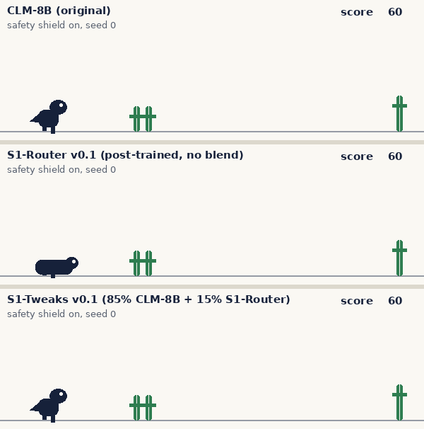
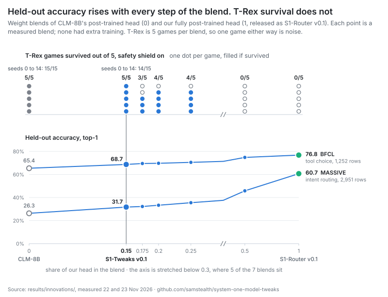

# System One Model Tweaks

Two drop-in heads for [CLM-8B](https://github.com/Contrastive-LM/CLM), the open "System One" decision model from Stanford and NVIDIA Research. You give CLM a situation and a list of options, and it picks one in a single pass, in 16 to 17 ms on one L40S in my runs.

[](LICENSE)
[](https://github.com/samstealth/system-one-model-tweaks/actions/workflows/ci.yml)
[](https://github.com/samstealth/system-one-model-tweaks/releases/tag/v0.1)

I post-trained CLM's head to get better at picking tools and routing requests. It got a lot better at that, and it forgot how to play CLM's dinosaur game. Blending 15% of the new weights into the original got it surviving again with the benchmark's safety shield on (19 of 20 games, against 20 of 20 for CLM) and kept a few points of the gains. Both heads are here, with the numbers and the things that didn't work.

<p align="center"></p>

<sub>The same course with the safety shield on. Top: CLM-8B. Middle: S1-Router, the post-trained head. Bottom: S1-Tweaks, the 15% blend. This is one recorded run. In a later run the blend lost this same course once.</sub>

## The two heads

| | S1-Tweaks v0.1 | S1-Router v0.1 |
|---|---|---|
| What it is | 85% CLM-8B and 15% S1-Router, averaged weight by weight. No training. | CLM-8B's head after 400 more training steps on multiple-choice data. |
| Use it for | Staying close to CLM, with a few extra points on tools and routing. | Routing and tool choice only. It can't play T-Rex. |
| File | `s1_tweaks_v0.1.pt` | `s1_router_v0.1.pt` |

Both are about 75 MB and sit on the [release page](https://github.com/samstealth/system-one-model-tweaks/releases/tag/v0.1). They use CLM's own checkpoint layout, so CLM's engine loads either one with `--ckpt`. The backbone is still the frozen Qwen3-8B. Only the heads changed.

## Results

Top-1 accuracy in %. Same backbone, same vectors and same scoring code for all three heads.

| Test | CLM-8B | S1-Tweaks | S1-Router |
|---|---|---|---|
| BFCL v3, tool choice | 65.4 | 68.7 | 76.8 |
| MASSIVE, intent routing | 26.3 | 31.7 | 60.7 |
| HWU64, intent routing | 29.5 | 34.4 | 57.3 |
| Bitext, support routing | 16.1 | 17.9 | 39.8 |
| SciQ, science questions | 56.5 | 60.3 | 69.8 |
| QASC, science questions | 36.4 | 39.0 | 48.6 |
| MMLU test | 28.9 | 29.2 | 31.6 |
| MedMCQA | 29.0 | 29.1 | 30.0 |
| General Q&A | 81.8 | 81.7 | 79.9 |
| T-Rex games survived, shield on | 20 of 20 | 19 of 20 | 0 of 5 |
| T-Rex deaths in 5 courses, shield off | 22 | 45 | 45 |
| DeepSWE tasks solved of 38, after CLM's fine-tune | 31.0 | 30.8 | not run |

Chance is 10% on the first four rows, 25% on SciQ, MMLU and MedMCQA, and 12.5% on QASC.

Keep these in mind when you read the table:

- T-Rex is a near-tie, and only with the benchmark's safety shield on. With the shield off CLM-8B is far better, and no head survives a full course.
- The first eight rows are my own multiple-choice versions of public datasets (13,194 rows), not the datasets' official metrics. CLM never saw this option format. Seven of the sources were never trained on. MMLU's auxiliary train set was.
- The six gains for S1-Tweaks hold up in a paired test: +3.8 points pooled, 95% interval 3.4 to 4.3. MMLU and MedMCQA don't move.
- DeepSWE is scored after fine-tuning each head with CLM's script, so it only says the blend is as good a starting point.
- This is small-scale work: 400 training steps on 233k rows, about $68 of GPU time, each run done once.

Full tables are in [`MODEL_CARD.md`](MODEL_CARD.md) and [`innovations/RESULTS.md`](innovations/RESULTS.md). Raw numbers are in [`results/innovations/`](results/innovations/).

## Try it

No GPU needed, Python 3.10 or newer.

```bash
git clone https://github.com/samstealth/system-one-model-tweaks
cd system-one-model-tweaks
python -m venv .venv && source .venv/bin/activate
pip install -e .
python examples/demo_cpu.py
```

The demo downloads the three heads, scores 60 real decisions on your CPU and prints them side by side:

```text
State:
    Customer message: still waiting on that card

    Which team should handle this ticket?

   #  option                                              CLM-8B   S1-Tweaks v0.1   S1-Router v0.1
   2  getting spare card: Route the ticket to ...           7.5%             8.1%            30.8%
   4  card arrival: Route the ticket ...  <- gold           4.0%             5.7%            65.6% *
   7  top up by cash or cheque: Route the tick...          56.5% *          54.0% *           1.0%
   8  cancel transfer: Route the ticket to can...          13.0%            13.3%             0.4%
  [6 more options]
  * = that head's pick.   CLM-8B: wrong   S1-Tweaks v0.1: wrong   S1-Router v0.1: right
```

On those 60 decisions CLM-8B gets 29 right, S1-Tweaks 34 and S1-Router 47. On Linux, running `pip install torch --index-url https://download.pytorch.org/whl/cpu` first skips the large CUDA wheels.

## Use a head

```python
import numpy as np
from innovations.scorer import load_head, blend

z = np.load("examples/data/sample_decisions.npz")       # the 60 sample decisions
state, options = z["q"][0], z["opts"][0][: z["n_opts"][0]]

head = load_head("s1-tweaks")            # or "s1-router", "clm", a local .pt file
print(head.probs(state, options))        # one probability per option

mine = blend("clm", "s1-router", 0.2)    # your own blend, no training
mine.save("my_head.pt")                  # CLM's layout, ready for clm-serve --ckpt
```

The heads read Qwen3-8B vectors, so new text needs the backbone on a GPU. [`examples/route_text.py`](examples/route_text.py) goes from text to an answer, and the [model card](MODEL_CARD.md#how-to-use-it) shows how to serve a head with CLM's own engine.

## How it works

CLM-8B is a frozen Qwen3-8B plus two small MLP heads, 18.9M parameters together. The backbone turns the situation and each option into a vector. The heads map both into the same 512-dimensional space, and a softmax over the cosine similarities gives one probability per option. I never train the backbone. Everything here changes the heads.

## What happened

1. I built 233k training rows shaped like the question CLM gets asked: one situation, up to 10 options. After 400 steps of post-training on them, tool choice on BFCL went from 65.4% to 76.8%. That head is S1-Router.
2. Then I ran T-Rex, CLM's real-time benchmark. CLM-8B survived 5 of 5 courses. S1-Router survived none.
3. Four fixes failed: a gentler training run, distilling toward CLM's head, distilling with a strong anchor (it kept the game and learned nothing), and adding agent data.
4. Averaging the weights worked, up to a point. At 15% the blend survived 19 of 20 games with the shield on. Bigger blends score higher on the tests above but lost games in their 5-course runs: 3 or 4 of 5 survived at 17.5% to 25%, and 0 of 5 at 50%.

<picture><source media="(prefers-color-scheme: dark)" srcset="assets/blend-tradeoff-dark.svg"></picture>

Every run, including the failed ones, is written up in [`innovations/RESULTS.md`](innovations/RESULTS.md).

## Other experiments

| Idea | Result |
|---|---|
| Swap the backbone | The same small head trained on one 96k-pair slice, tricky Q&A: Muse Glimmer 30B 36.9%, Qwen3-8B 34.2%, Inkling 2 Mini 31.8%. This is a screening test. Neither released head uses Muse or Inkling. |
| Smaller embeddings | One Matryoshka head scores 58.7% to 58.8% on general Q&A at every size from 64 to 1,024 dimensions. |
| Quantize the backbone | At 256 tokens, FP8 cuts a backbone pass from 22.0 to 16.8 ms and costs 0.7 points of tricky Q&A. AWQ 4-bit takes 13.8 ms and costs 4.5 points. |
| One shared head | 64.8% on general Q&A against 56.5% for two separate heads, with half the parameters. |

The embedding and shared-head rows are short CPU runs (3,000 steps, one seed), so they show what learns faster, not where it ends up.

## What didn't work

- Keeping T-Rex by training instead of blending (step 3 above).
- T-Rex with the shield off. Every head that gained anything dies 45 times in 5 courses, against 22 for CLM-8B.
- int8 activations in the head: tricky Q&A fell from 68.8% to 49.1%.
- Inkling 2 Mini took five attempts to run, then scored lowest of the three backbones.

## Limits

- T-Rex is 20 games per head with the shield on (5 for S1-Router), and the 15% blend was picked on the first 5.
- S1-Tweaks is still a weak router in absolute terms: 31.7% on MASSIVE with 10 options.
- Tested in English and on top-1 accuracy only. I haven't checked whether the probabilities are calibrated.
- This is not an official CLM release, and the CLM authors haven't reviewed these heads.

## Reproduce

[`docs/REPRODUCE.md`](docs/REPRODUCE.md) has the command, hardware and cost of every run. If you want to try something yourself, [`CONTRIBUTING.md`](CONTRIBUTING.md) lists open questions, and some need no GPU.

```bash
pip install -e ".[dev]" && python -m pytest -q tests        # 28 CPU tests, no data, no network
pip install matplotlib && python scripts/make_figures.py    # rebuild the figures
```

## Credits and licence

[CLM](https://contrastive-lm.notion.site) is by Jacky Kwok, Hangoo Kang, Tarun Suresh, Jon Saad-Falcon, Marco Pavone, Christopher Ré and Azalia Mirhoseini at Stanford and NVIDIA Research. The architecture, the engine, the T-Rex benchmark and the [weights](https://huggingface.co/Contrastive-LM/CLM-v0.1-8B) these heads start from are theirs. The backbone is Qwen3-8B by the Qwen team. The blend is plain weight interpolation, as in WiSE-FT (Wortsman et al., 2022).

Apache 2.0. Both heads are modified copies of CLM's Apache 2.0 weights. [`NOTICE`](NOTICE) lists the third-party code and the licence of every dataset, and some datasets don't allow commercial use. To cite this repo, use "Cite this repository" on GitHub, and please cite CLM too.
