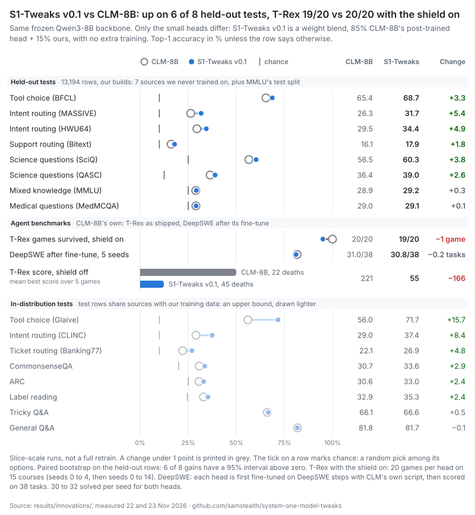
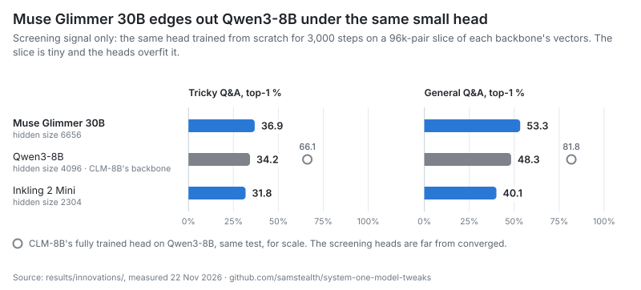
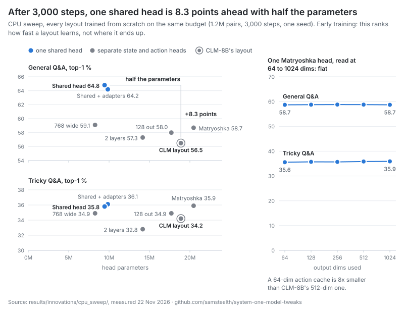
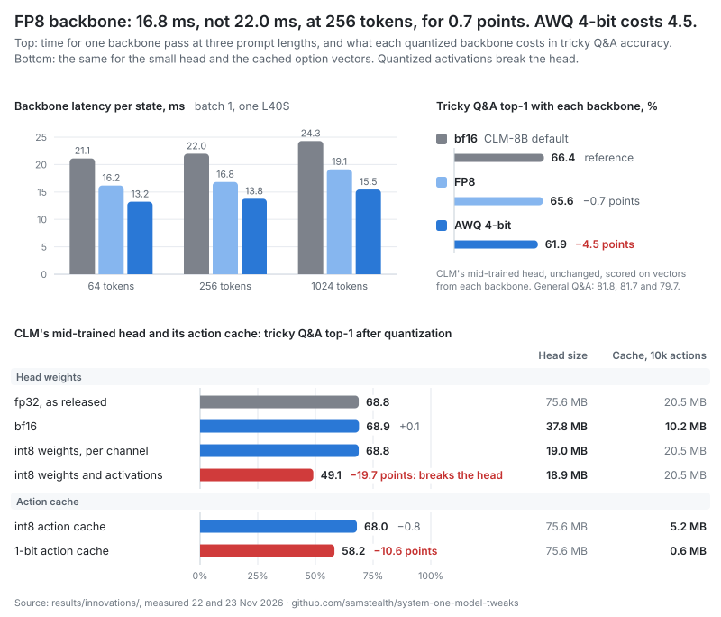

# System One Model Tweaks

**Two drop-in heads and five measured experiments for CLM-8B, an open "System One" model from Stanford and NVIDIA Research that picks one option from a list in a single fast pass instead of writing text.**

[](LICENSE)
[](https://github.com/samstealth/system-one-model-tweaks/actions/workflows/ci.yml)
[](https://github.com/samstealth/system-one-model-tweaks/releases/tag/v0.1)
[](https://github.com/samstealth/system-one-model-tweaks/stargazers)

We post-trained an open decision model to pick tools and routes far better, and it forgot how to play a dinosaur game. Blending 15% of the new weights into the old ones got back 19 of 20 games (the original survives 20 of 20) and kept gains of 1.8 to 5.4 points on 6 of 8 public test sets that our training never touched.

This repo is the lab notebook: two heads you can download, five experiments, every measured number tied to a result file, and the failures left in. It is an independent project, not an official CLM release.

```bash
git clone https://github.com/samstealth/system-one-model-tweaks && cd system-one-model-tweaks
pip install -e .
python examples/demo_cpu.py    # no GPU: scores 60 real decisions on your CPU
```

<picture><source media="(prefers-color-scheme: dark)" srcset="assets/hero-dark.svg"></picture>

<sub>Grey is CLM-8B, blue is S1-Tweaks v0.1. Same frozen backbone and same serving engine. Only the head weights differ. The held-out gains are modest, T-Rex is a near-tie only with the safety shield on, and all of this is slice-scale work. See [Limitations](#limitations).</sub>

**Jump to:** [scoreboard](#the-scoreboard) · [pick a head](#pick-a-head) · [lab notebook](#the-lab-notebook) · [what is a System One model?](#what-is-a-system-one-model) · [quickstart](#quickstart) · [five experiments](#the-five-experiments) · [what failed](#what-failed) · [limitations](#limitations)

## The scoreboard

CLM-8B is a frozen Qwen3-8B plus two small trained heads (18.9M parameters together). **S1-Tweaks v0.1** is a new pair of heads: every weight is 85% CLM-8B's and 15% ours, with no training after the blend. Both columns use the same backbone, the same vectors and the same scoring code. Top-1 accuracy in % unless the row says otherwise.

| Test | CLM-8B | S1-Tweaks v0.1 | Change |
|---|---|---|---|
| **Held-out sources, never trained on** (rows) | | | |
| BFCL v3, tool choice (1,252) | 65.4 | **68.7** | +3.3 |
| MASSIVE, intent routing (2,951) | 26.3 | **31.7** | +5.4 |
| HWU64, intent routing (1,072) | 29.5 | **34.4** | +4.9 |
| Bitext, support routing (2,000) | 16.1 | **17.9** | +1.8 |
| SciQ, science questions (1,000) | 56.5 | **60.3** | +3.8 |
| QASC, science questions (923) | 36.4 | **39.0** | +2.6 |
| MMLU test, mixed knowledge (1,997) | 28.9 | 29.2 | flat (+0.3) |
| MedMCQA, medical questions (1,999) | 29.0 | 29.1 | flat (+0.1) |
| **Skills CLM-8B already had** | | | |
| T-Rex, shield on: games survived, two runs | **20/20** | 19/20 | near-tie, one game behind |
| T-Rex, shield off: deaths in 5 courses | **22** | 45 | CLM-8B far better (score 221 against 55) |
| DeepSWE: tasks solved out of 38, mean of 5 seeds | 31.0 | 30.8 | tie within seed noise |
| Tricky Q&A (gold answer against up to 10 hard negatives) | 66.1 | 66.6 | flat (+0.5) |
| General Q&A (in-batch retrieval) | 81.8 | 81.7 | flat (-0.1) |

Read these before you quote the table:

- **T-Rex is a near-tie, not a tie.** T-Rex is CLM's real-time benchmark: keep Chrome's offline dinosaur alive for 60 seconds per course. The first run (seeds 0 to 4) was 5/5 for both heads. A second run over seeds 0 to 14 was 14/15 against 15/15, with mean best score 685.8 against 697.0. So the 20 games cover 15 distinct courses. S1-Tweaks v0.1 also agrees with the game's reference planner less often (54.3% of decisions against 64.8%), so it leans on the safety shield more.
- **With the shield off, CLM-8B is far better.** The shield replaces an answer that the planner labelled unsafe. Without it, over 5 seeds, CLM-8B dies 22 times and scores 221. S1-Tweaks v0.1 dies 45 times and scores 55.
- **Held-out gains are smaller than in-distribution gains.** Tool choice is +15.7 on Glaive, a source we trained on, and +3.3 on BFCL, a source we did not. The held-out rows use the same option templates as the training data. No confidence intervals were computed.
- **This is slice-scale work.** The post-training run was 400 steps on 233k choice rows, not a full-scale retrain. The Q&A tests use a rebuilt 12k-pair slice with contexts cut to 512 tokens, so they read lower than CLM's published numbers (66.1% here against 68.5% published for the same head).
- **DeepSWE is a tie, not a win.** Per seed: 31, 32, 30, 31, 31 for CLM-8B and 30, 32, 30, 31, 31 for S1-Tweaks v0.1. There is little room to move: a random pick solves 28 of the 38 tasks and a perfect pick 34.

<details>
<summary>In-distribution tests (an upper bound: these test rows share sources with our training data)</summary>

| Test | CLM-8B | S1-Tweaks v0.1 | S1-Router v0.1 |
|---|---|---|---|
| Tool choice (Glaive function calling) | 56.0 | 71.7 | 97.5 |
| Ticket routing (Banking77) | 22.1 | 26.9 | 82.8 |
| Intent routing (CLINC) | 29.0 | 37.4 | 85.7 |
| Label reading | 32.9 | 35.3 | 51.9 |
| ARC | 30.6 | 33.0 | 42.1 |
| CommonsenseQA | 30.7 | 33.6 | 46.3 |
| Tricky Q&A | 66.1 | 66.6 | 68.2 |
| General Q&A | 81.8 | 81.7 | 79.9 |

</details>

Raw numbers: [`results/innovations/`](results/innovations/) (`heldout.json`, `trex.json`, `deepswe.json`, one JSON per run). Full write-up: [`innovations/RESULTS.md`](innovations/RESULTS.md).

## Pick a head

| | CLM-8B (original) | S1-Tweaks v0.1 | S1-Router v0.1 |
|---|---|---|---|
| Pick it when | you need CLM's exact behaviour, or T-Rex-like play with no safety shield | you want CLM's behaviour with better tool choice and routing | the job is routing or tool choice and nothing like T-Rex matters |
| How it is made | released by the CLM authors | 85% CLM-8B + 15% S1-Router, blended in weight space, no training | CLM-8B's head plus 400 post-training steps on choice data |
| Tool choice, BFCL (held-out) | 65.4% | 68.7% | **76.8%** |
| Intent routing, MASSIVE (held-out) | 26.3% | 31.7% | **60.7%** |
| T-Rex games survived, shield on | **20 of 20** | 19 of 20 | 0 of 5 |
| General Q&A | **81.8%** | 81.7% | 79.9% |
| File | `CLM_v0.1-8B.pt` | `s1_tweaks_v0.1.pt` | `s1_router_v0.1.pt` |

<picture><source media="(prefers-color-scheme: dark)" srcset="assets/heldout-dark.svg"></picture>

**S1-Router v0.1** is our fully post-trained head, with no blending. On the held-out test it is ahead of both other heads on all eight sources. It pays for that: it survives 0 of 5 T-Rex courses (17 deaths) and loses 1.9 points of general Q&A. It was also tested less, with no DeepSWE run and no 15-seed T-Rex run.

All three files use CLM's own checkpoint layout (`state_head`, `action_head`, `logit_scale`, `cfg`), so the official CLM engine serves any of them with `--ckpt`. Our two files are on the [v0.1 release page](https://github.com/samstealth/system-one-model-tweaks/releases/tag/v0.1), about 75 MB each. Sizes, checksums and intended use are in [`MODEL_CARD.md`](MODEL_CARD.md).

## The lab notebook

The [workshop this repo builds on](https://github.com/VizuaraAI/system-one-from-scratch) ends with five ideas for improving CLM-8B. We ran all five ([below](#the-five-experiments)). The fifth turned into a story, told here in the three rounds it took on 22 and 23 November 2026.

**Round 1. Teach it to choose.** A System One model is asked "which of these options?". So we built training rows shaped like that question: one situation, up to 10 options, and the wrong options of the same question as the hard negatives. That gave 233k rows built from public tool-calling, routing and multiple-choice sets. We post-trained CLM-8B's head on them for 400 steps, with 40% of every batch replaying CLM's own Q&A data so it would not forget that. It worked. On test rows from the same sources, tool choice went from 56.0% to 97.5%, ticket routing from 22.1% to 82.8% and intent routing from 29.0% to 85.7%. This head is now S1-Router v0.1.

**Then we ran the dinosaur.** CLM ships a real-time benchmark: Chrome's offline dinosaur game, 60 seconds per course, about 3,000 decisions per course. CLM-8B survived 5 of 5 courses. Our new head survived 0 of 5 and died 17 times.

**The clue.** CLM's own mid-trained head, the stage before the authors' agent post-training, also survives 0 of 5. So the T-Rex skill comes from that last training stage, and our 400 steps wrote over it.

**Four fixes that failed.** One of them kept the game, by learning nothing.

| Attempt | T-Rex courses survived, shield on | Tool choice (Glaive) |
|---|---|---|
| Gentler run: lower learning rate, 200 steps, 50% replay | 0/5 | 93.3% |
| Distill toward CLM-8B's head while training | 0/5 | 83.1% |
| Distill plus a strong L2 anchor to CLM-8B's weights | 5/5 | 56.4% (CLM-8B: 56.0%) |
| Add 118k agent steps from ADP, with distillation | 2/5 | 83.0% |

**Round 2. The fix was not training.** Take the two heads and blend their weights: 85% CLM-8B, 15% ours. One command, no gradient step:

```bash
python -m innovations.interpolate --a CLM_v0.1-8B.pt --b s1_router_v0.1.pt \
    --alpha 0.15 --out my_blend.pt
```

<picture><source media="(prefers-color-scheme: dark)" srcset="assets/blend-tradeoff-dark.svg"></picture>

| Share of our head | T-Rex survived, shield on, 5 seeds | BFCL (held-out) | MASSIVE (held-out) |
|---|---|---|---|
| 0 (CLM-8B) | 5/5, then 15/15 over 15 seeds | 65.4% | 26.3% |
| **0.15 (S1-Tweaks v0.1)** | **5/5**, then 14/15 over 15 seeds | 68.7% | 31.7% |
| 0.175 | 3/5 | 69.5% | 32.2% |
| 0.2 | 4/5 | 69.7% | 33.3% |
| 0.25 | 4/5 | 70.5% | 35.5% |
| 0.5 | 0/5 | 74.8% | 45.8% |
| 1 (S1-Router v0.1) | 0/5 | 76.8% | 60.7% |

Held-out accuracy rises with every step of the blend. T-Rex does not. It holds at 15% and breaks just above it: 17.5% loses 2 of 5 courses, and 50% dies 41 times. Survival is not even monotonic in the share, which says that 5 games is a noisy measure. So 15% is the largest blend that survived all five courses, and in a longer run even it lost one. It is not a safe middle.

**Round 3. Try to break it.**

- **More seeds.** Over seeds 0 to 14, S1-Tweaks v0.1 survived 14 and CLM-8B survived 15. The one death was on seed 0, which the same head survived in the first run, so real-time play is not fully deterministic. Together: 19 of 20 games against 20 of 20.
- **Shield off.** Without the safety shield, every blend we made dies 45 times in 5 seeds, against 22 for CLM-8B.
- **DeepSWE.** CLM's coding-verifier test, over 5 seeds: 30.8 of 38 tasks solved against 31.0.
- **Sources it never saw.** [`build_heldout_choice.py`](innovations/build_heldout_choice.py) builds 13,194 test rows from eight public sources that none of our training touched, with the same option templates as the training data. Rows whose question text also appears in our training file were dropped (34 in all). OpenBookQA is left out on purpose, because the MMLU auxiliary set we trained on contains it. The gains carried over at a smaller size: tool choice +3.3, routing +1.8 to +5.4, science questions +2.6 and +3.8, and nothing on MMLU or MedMCQA.

**What we take from it.** In this model, a skill learned in the last training stage was erased by 400 steps on other data. Distillation did not protect it. A plain weight average did, mostly, and only with the shield on. All three rounds cost about $69 of cloud GPU time. Every attempt is in the notes: [round 1](results/innovations/slice_run_2026-11-22.md), [round 2](results/innovations/day2_2026-11-22.md), [round 3](results/innovations/day3_2026-11-23.md).

## What is a System One model?

A System One model makes fast decisions instead of writing text. You give it a state (the situation) and a list of options. It returns a probability for each option in one pass.

[CLM-8B](https://github.com/Contrastive-LM/CLM), from Stanford and NVIDIA Research, is an open one. A frozen Qwen3-8B turns each text into 4096 numbers. Two small heads, 9.44M parameters each, map the state and each option to 512 numbers. The score is their cosine similarity times a learned scale, then a softmax over the options. Option vectors can be computed once and cached. In our T-Rex runs, with their short prompts, the median decision took 16 to 17 ms on one L40S, for every head. One backbone pass alone took 21 to 24 ms at 64 to 1,024 tokens (batch 1).

This repo never trains the backbone. It changes the heads, and it measures what happens when the backbone is swapped or quantized.

<picture><source media="(prefers-color-scheme: dark)" srcset="assets/architecture-dark.svg"></picture>

## Quickstart

### 1. No GPU

```bash
git clone https://github.com/samstealth/system-one-model-tweaks
cd system-one-model-tweaks
pip install -e .
python examples/demo_cpu.py
```

The repo ships 60 real decisions with their Qwen3-8B vectors already computed: 12 each from Glaive function calling, Banking77, CLINC, BFCL and MASSIVE. The demo downloads CLM-8B's head from Hugging Face and our two heads from the release page. Ours are checked against a pinned sha256, and every file is loaded with `weights_only=True`, so a download cannot run code. It scores every decision with each head, prints a few side by side and ends with the accuracy per source. Only the heads run, so the scoring takes well under a second on a CPU.

On Linux, `pip install torch --index-url https://download.pytorch.org/whl/cpu` before the install skips the large CUDA wheels.

```text
--- decision 13 of 60, source: banking77 --------------------
State:
    Customer message: still waiting on that card

    Which team should handle this ticket?

   #  option                                                                                CLM-8B
   0  pending cash withdrawal: Route the ticket to pending cash withdrawal.                   2.0%
   1  cash withdrawal charge: Route the ticket to cash withdrawal charge.                     7.6%
   2  getting spare card: Route the ticket to getting spare card.                             7.5%
   3  unable to verify identity: Route the ticket to unable to verify identity.               1.2%
   4  card arrival: Route the ticket to card arrival.  <- gold                                4.0%
   5  lost or stolen card: Route the ticket to lost or stolen card.                           4.6%
   6  card swallowed: Route the ticket to card swallowed.                                     0.5%
   7  top up by cash or cheque: Route the ticket to top up by cash or cheque.                56.5% *
   8  cancel transfer: Route the ticket to cancel transfer.                                  13.0%
   9  verify top up: Route the ticket to verify top up.                                       3.1%
  * = that head's pick.   CLM-8B: wrong
[...]
Top-1 accuracy on this sample (60 decisions). Chance is the mean of 1 / number of options.
  source               n   chance           CLM-8B
  banking77           12    10.0%            16.7%
  clinc_oos           12    10.0%            41.7%
  glaive_fc           12    10.0%            83.3%
  heldout_bfcl        12    10.0%            58.3%
  heldout_massive     12    10.0%            41.7%
  all                 60    10.0%            48.3%

Scored 60 decisions with 1 head in 0.07 s on CPU. Only the heads ran here; the backbone vectors were computed in advance.
```

<!-- PENDING: the block above is a real run from before the v0.1 release was live, so it has the CLM-8B column only. Once the release is live, replace it with the three-column output (CLM-8B, S1-Tweaks v0.1, S1-Router v0.1) of python examples/demo_cpu.py. The per-source numbers of the two S1 heads on this sample are not in any result file yet. -->

This capture is from before the v0.1 release went live, so it has CLM-8B's column only: 29 of 60. With the release live you get one column per head. S1-Tweaks v0.1 gets 34 of 60 on this sample ([round 3 notes](results/innovations/day3_2026-11-23.md)). Sixty decisions give rough numbers, so quote the scoreboard and not this. `python examples/demo_cpu.py --show 6 --disagreements` prints the decisions where the heads differ.

### 2. Use a head

**With the official CLM engine.** Both files use CLM's own layout, so [the engine](https://github.com/Contrastive-LM/CLM) serves them unchanged. This is the path our T-Rex runs used.

```bash
pip install contrastive-lm
curl -LO https://github.com/samstealth/system-one-model-tweaks/releases/download/v0.1/s1_tweaks_v0.1.pt
# sha256: c0a32217d1288d8452046bda9bcb045b53b052b943ef7de42652691e057fd9d9
vllm serve Qwen/Qwen3-8B --served-model-name qwen3-8b --runner pooling \
    --max-model-len 2048 --port 8090 &    # the encoder, needs a GPU
clm-serve --ckpt s1_tweaks_v0.1.pt        # CLM API on :8700 with this head (or s1_router_v0.1.pt)
```

```python
from clm import CLMClient, Choice

r = CLMClient().system_one(                   # http://127.0.0.1:8700 by default
    state="Customer: my invoice was charged twice and nobody answers the phone!",
    questions={"team": Choice(instructions="Which team should handle this?",
                              criteria={"billing": "billing: Charges, invoices, refunds",
                                        "technical": "technical: Bugs and outages"})})
print(r.answers["team"].choice, r.answers["team"].probabilities)
```

> **Write each option as `name: description`.** The engine sends an option's description to the encoder exactly as written and adds no name in front. The choice data behind our heads writes options as `name: description`, so repeat the name inside the description, as above. Pins that worked for us: `vllm==0.11.0`, `transformers<5`, CLM at commit `d5f9ef0`.

**In Python, on vectors you already have.** A CPU is enough for the head. [`innovations/scorer.py`](innovations/scorer.py) is the whole public API:

```python
from innovations.scorer import load_head, blend

head = load_head("s1-tweaks")                # or "s1-router", "clm", a local .pt file, an https URL
probs = head.probs(state_vec, option_vecs)   # Qwen3-8B vectors (4096,), (K, 4096) -> (K,) probabilities
cache = head.embed_options(tool_vecs)        # embed a fixed option list once and reuse it
mine = blend("clm", "s1-router", 0.2)        # your own point on the trade-off, no training
mine.save("my_head.pt")                      # CLM's layout, ready for clm-serve --ckpt
```

`blend("clm", "s1-router", 0.15)` is the S1-Tweaks v0.1 recipe.

**Text in, with a GPU.** [`examples/route_text.py`](examples/route_text.py) embeds text with Qwen/Qwen3-8B through transformers (a GPU with 24 GB or more) and scores it. It is for trying things out. For serving, use the engine.

```bash
pip install -e ".[text]"
python examples/route_text.py --head s1-tweaks \
    --state "Customer: my invoice was charged twice and nobody answers the phone!" \
    --instructions "Which team should handle this?" \
    --option "billing: Charges, invoices, refunds" --option "technical: Bugs and outages"
```

### 3. Reproduce

[`docs/REPRODUCE.md`](docs/REPRODUCE.md) has the command, hardware and cost of every run, and says which commands were recorded, which were rebuilt afterwards and which were rerun as a check. The head layout sweep and the head quantization run on a CPU for free. The GPU runs used [Modal](https://modal.com). Everything here, failures included, cost about $69: $42.33 for round 1, about $21 for round 2 and about $5 to $7 for round 3 (billing read $68.20 before the last runs were metered).

```bash
pip install -e ".[dev]" && python -m pytest -q tests        # 28 CPU tests, no data, no network
pip install matplotlib && python scripts/make_figures.py    # rebuild every figure
```

## The five experiments

Full tables and methods are in [`innovations/RESULTS.md`](innovations/RESULTS.md). Experiment 5 is the lab notebook above.

| # | Idea | Key result | Verdict |
|---|---|---|---|
| 1 | Swap the backbone | Same head, one 96k-pair slice, tricky Q&A: Muse Glimmer 30B 36.9%, Qwen3-8B 34.2%, Inkling 2 Mini 31.8% | Screening signal only. Muse Glimmer leads. Inkling needed a B200 GPU and a patched vLLM image. |
| 2 | Smaller embeddings | One Matryoshka head scores 58.7% to 58.8% general Q&A at every size from 64 to 1024 dims | Worked early in training. A 64-dim action cache is 8x smaller than CLM's 512-dim one. Open at full scale. |
| 3 | Quantize | FP8 backbone: 16.8 ms per pass against 22.0 ms, for 0.7 points of tricky Q&A. AWQ 4-bit: 13.8 ms, for 4.5 points. | FP8 worked. bf16 and int8-weight heads are free. int8 activations break the head (68.8% to 49.1%). |
| 4 | One shared head | 64.8% general Q&A against 56.5% for two separate heads, with 9.4M parameters instead of 18.9M | Worked early in training (CPU, 3,000 steps). It may only learn faster. Open at full scale. |
| 5 | Post-train on choices | Held-out BFCL 65.4% to 76.8%, MASSIVE 26.3% to 60.7%. T-Rex 5/5 to 0/5. | Worked for tools and routing, failed for T-Rex. A 15% blend keeps most of T-Rex: that is S1-Tweaks v0.1. |

<details>
<summary>1. New backbone: figure, numbers, code</summary>

<picture><source media="(prefers-color-scheme: dark)" srcset="assets/backbones-dark.svg"></picture>

The same head was trained from scratch for 3,000 steps on each backbone's vectors of one 96k-pair slice. All three heads overfit the slice, so this ranks backbones and is not a final score. Latency was timed for the Qwen variants only. Getting Inkling 2 Mini to run took five attempts ([notes](results/innovations/inkling_attempts.md)). Code: [`build_qa_text.py`](innovations/build_qa_text.py), [`modal_embed.py`](innovations/modal_embed.py), [`modal_train.py`](innovations/modal_train.py). RESULTS section 4.

</details>

<details>
<summary>2 and 4. Embedding size and a shared head: figure, numbers, code</summary>

<picture><source media="(prefers-color-scheme: dark)" srcset="assets/head-layouts-dark.svg"></picture>

CPU, from scratch, matched budget: 1.2M published pairs, batch 1,024, 3,000 steps, seed 1234. That is far from convergence, so it ranks layouts by how fast they learn and says nothing yet about where they end up. Dropping the hidden block hurts tricky Q&A (32.8% against 34.2%). Halving the width does not (34.9%). A shared head cannot be saved in CLM's layout, so the official engine cannot serve it as is. Code: [`heads.py`](innovations/heads.py), [`train.py`](innovations/train.py), [`sweep_cpu.sh`](innovations/sweep_cpu.sh). RESULTS section 3.

</details>

<details>
<summary>3. Quantization: figure, numbers, code</summary>

<picture><source media="(prefers-color-scheme: dark)" srcset="assets/quantization-dark.svg"></picture>

Timings are batch 1 on one L40S with vLLM 0.11. At 256 tokens FP8 cuts latency by 23% and AWQ 4-bit by 37%. CLM's mid-trained head, unchanged, then scores 66.4% (bf16), 65.6% (FP8) and 61.9% (AWQ) on tricky Q&A. The two released heads were not scored on quantized vectors. Head weights: bf16 halves the file (37.8 MB) and int8 weights quarter it (19.0 MB) at no cost in accuracy. An int8 action cache is about 4x smaller for 0.8 points. Code: [`quantize_heads.py`](innovations/quantize_heads.py), [`modal_embed.py`](innovations/modal_embed.py). RESULTS section 2.

</details>

## What failed

- **Every blend above 15%.** T-Rex courses survived with the shield on: 3/5 at 17.5%, 4/5 at 20% and at 25%, 0/5 at 50%.
- **Keeping T-Rex by training.** A gentler run: 0/5. Distillation toward CLM-8B's head: 0/5. Distillation plus a strong L2 anchor: 5/5, and no gain on any test.
- **Our agent-data mix.** 118,465 training pairs from 34 ADP configs got 2/5 with distillation and 0/5 without. It does not reproduce the authors' agent post-training.
- **T-Rex with the shield off.** Every head that gained anything dies 45 times in 5 seeds. CLM-8B dies 22 times, and so does the anchored copy that learned nothing.
- **Replay without hard negatives.** Our first post-training run replayed plain Q&A pairs, and tricky Q&A fell to 60.9% against CLM-8B's 66.1%. With hard negatives in the replay it rose to 68.7%.
- **int8 activations in the head.** Tricky Q&A fell from 68.8% to 49.1%. A 1-bit action cache fell to 58.2%.
- **AWQ 4-bit as a free speed-up.** It is the fastest backbone we timed, and it costs 4.5 points of tricky Q&A.
- **Inkling 2 Mini.** Five attempts, a B200 GPU and a patched vLLM image to run it. Then it scored lowest of the three backbones.

## Limitations

- **T-Rex.** S1-Tweaks v0.1 is a near-tie with CLM-8B only with the shield on, and it agrees with the planner less often. With the shield off it is far behind. S1-Router v0.1 cannot play it at all.
- **Held-out gains are modest.** They are a fraction of the in-distribution gains, and two of eight sources are flat. S1-Tweaks v0.1 is still a weak router in absolute terms: 31.7% on MASSIVE and 17.9% on Bitext, with up to 10 options. The test shares its option templates with our training data. Its BFCL rows are our own multiple-choice build from BFCL v3 files, not the BFCL run CLM reports. No confidence intervals were computed.
- **Small samples.** T-Rex is 20 games per head with the shield on (5 for S1-Router v0.1) and 5 with it off. In the baseline's run of 6 November, CLM-8B's own head survived 4 of 5 courses, so one game is inside the noise. DeepSWE is 5 seeds on 38 tasks. Each training run was done once.
- **Slice scale.** 400 post-training steps. Experiments 1, 2 and 4 are early-training screens. No full-scale retrain was run.
- **Not checked.** The released heads on FP8 or AWQ vectors, languages other than English, and calibration of the probabilities. Only top-1 accuracy was measured. CLM's WikiRacing, Super Mario and Terminal-Bench tests could not be rerun, because their harnesses or candidate sets are not public.
- **The backbone still needs a GPU.** The CPU demo runs only the heads, on vectors computed in advance. A head reads Qwen3-8B vectors and nothing else.
- **Not an official CLM release.** The CLM authors have not reviewed these heads.

## Open questions

All are cheap to test, and some need no GPU. [`CONTRIBUTING.md`](CONTRIBUTING.md) says where each one starts and how to report a result. A rerun of one of our numbers is as welcome as a new result, whether it agrees or not.

- Is there a blend or a recipe that gains on choice tests and keeps T-Rex with the shield off? Not tried: weights below 0.15, blending one head only, one weight per layer.
- Which agent data brings back CLM's T-Rex skill? Our ADP mix reached 2/5.
- Do the shared head and the 64-dim embedding hold up after full training? The shared-head check is estimated at about $10.
- Can int8 activations be made to work with calibration or outlier clipping? Are the probabilities calibrated? Both run on a CPU.
- How do S1-Tweaks v0.1 and S1-Router v0.1 score on FP8 or AWQ vectors?

## Repo map

```text
innovations/           the five experiments: heads, trainer, evals, data builders, Modal jobs
  RESULTS.md           every measured number, with its limits
  scorer.py            public API: load_head, Scorer, blend
  interpolate.py       the blend
examples/              demo_cpu.py (no GPU), route_text.py (GPU), data/ (60 sample decisions)
results/innovations/   one JSON per run, plus the notes of each round
assets/  scripts/      figures, rebuilt from the result files by scripts/make_figures.py
tests/                 CPU tests on synthetic vectors
docs/                  REPRODUCE.md (commands and costs), BASELINE.md (the Vizuara README)
pipeline/  site/       the imported Vizuara baseline: trainer, game and test runners, deck
MODEL_CARD.md  CONTRIBUTING.md  CITATION.cff  NOTICE  LICENSE
```

## Credits

- **CLM** is by Jacky Kwok, Hangoo Kang, Tarun Suresh, Jon Saad-Falcon, Marco Pavone, Christopher Ré and Azalia Mirhoseini, at Stanford and NVIDIA Research. The architecture, the checkpoint layout, the serving engine, the T-Rex benchmark and the weights our heads start from are theirs: [blog](https://contrastive-lm.notion.site), [code](https://github.com/Contrastive-LM/CLM), [weights](https://huggingface.co/Contrastive-LM/CLM-v0.1-8B).
- **Vizuara AI Labs** rebuilt CLM-8B's training from scratch for a live workshop: [repo](https://github.com/VizuaraAI/system-one-from-scratch), [video](https://www.youtube.com/watch?v=vEpkc44bHVQ), [site](https://system-one-workshop.vercel.app). This repo imports that baseline (`pipeline/`, `site/`, `results/`), and the five ideas come from the workshop's last chapter. Their README is kept at [`docs/BASELINE.md`](docs/BASELINE.md).
- **Qwen3-8B** by the Qwen team is the frozen backbone. It is not included here.
- **The blend** is plain weight interpolation in the style of WiSE-FT (Wortsman et al., 2022).
- **Training data:** Banking77, CLINC, Glaive function calling v2, ARC, CommonsenseQA, the MMLU auxiliary set, CLM's published Q&A vectors and hard negatives, and ADP v2 for the agent mix.
- **Held-out test data:** BFCL v3, Amazon MASSIVE, HWU64, Bitext customer support, SciQ, QASC, the MMLU test set and MedMCQA.

## Licence and how to cite

Apache 2.0. See [`LICENSE`](LICENSE) and [`NOTICE`](NOTICE). S1-Tweaks v0.1 and S1-Router v0.1 are modified copies of CLM's Apache 2.0 weights, and `NOTICE` lists what was changed. Each dataset keeps its own licence, and some do not allow commercial use. The 60 sample rows in `examples/data/` stay under the licences of their sources, which `NOTICE` lists.

To cite this repo, use the "Cite this repository" button, which reads [`CITATION.cff`](CITATION.cff). Please also cite CLM, which all of this builds on:

```bibtex
@misc{kwok2026contrastivelanguagemodels,
  title={Contrastive Language Models},
  author={Jacky Kwok and Hangoo Kang and Tarun Suresh and Jon Saad-Falcon and Marco Pavone and Christopher Ré and Azalia Mirhoseini},
  year={2026},
  note={Notion Blog},
  url={https://contrastive-lm.notion.site}
}
```
